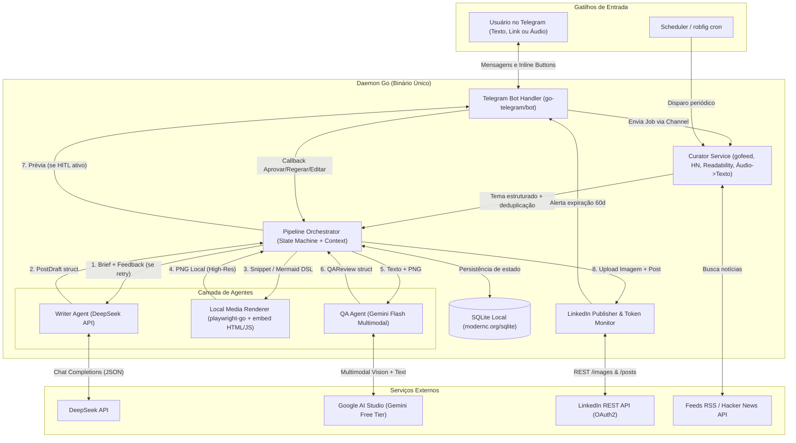
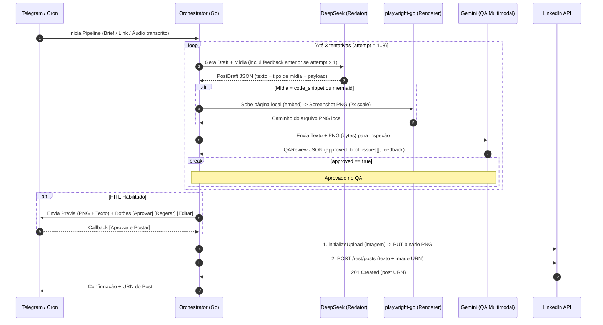

# Plano de Arquitetura e Implementação — LinkedIn Autonomous Tech Publisher (Stack Go)

## Visão Geral e Objetivo

Sistema **local-first** compilado como um **binário único em Go** (executável via Docker Compose ou serviço `systemd` em Linux) para curadoria, redação, renderização de mídia, revisão multimodal e publicação autônoma de posts técnicos no LinkedIn, controlado via **Telegram Bot**.

O sistema opera em dois modos:
1. **Sob demanda (Telegram):** O usuário envia uma ideia em texto, um link de artigo/repositório ou uma **mensagem de voz** (transcrita/interpretada diretamente via Gemini Multimodal Free Tier, mantendo custo zero).
2. **Periódico (Scheduler/Cron):** Em horários configurados, o daemon coleta feeds RSS técnicos e Hacker News, filtra temas inéditos contra o histórico local (SQLite), seleciona o tópico mais relevante e dispara o pipeline automaticamente.

> [!IMPORTANT]
> **Restrição de Custo (~R$ 0,00):**
> - **Redação:** DeepSeek API (`deepseek-chat` / `deepseek-reasoner` — custo residual de frações de centavo por post; endpoint compatível com OpenAI).
> - **Revisão (Texto + Visão + Áudio):** Google Gemini API via **Google AI Studio Free Tier** (`gemini-2.5-flash` / `gemini-2.0-flash` — cota gratuita generosa com suporte nativo a texto, imagem e áudio).
> - **Mídia:** Renderização 100% local via **Playwright (`playwright-go` + Chromium headless)** a partir de templates HTML/CSS embutidos no binário (`//go:embed`) com **Highlight.js** (syntax highlighting) e **Mermaid.js** (diagramas), exportando PNG de alta resolução (`DeviceScaleFactor: 2`).

---

## 1. Escolha da Stack de Backend: **Go 1.23+**

### Por que Go se encaixa bem aqui
- **Daemon resiliente e baixo consumo:** Binário estático único, uso mínimo de RAM em idle (ideal para rodar 24/7 em VPS barata, Raspberry Pi ou homelab).
- **Concorrência nativa:** Goroutines, `context.Context` com timeouts por etapa e canais facilitam isolar o bot do Telegram, o scheduler cron, o monitor de token OAuth2 e os jobs do pipeline com graceful shutdown (`os.Signal`).
- **SQLite sem CGO:** Uso de **`modernc.org/sqlite`** (driver Pure Go), eliminando dependências de compilador C (`gcc`) no build e simplificando o `Dockerfile` multi-stage.
- **Templates e Assets embutidos:** Com `//go:embed`, os templates HTML/CSS e os bundles locais de `highlight.js` e `mermaid.min.js` ficam dentro do próprio binário Go.

### Bibliotecas e Dependências Principais (`go.mod`)
- **Telegram Bot:** `github.com/go-telegram/bot` (suporte moderno a Context, middlewares, inline keyboards e download de arquivos/áudio).
- **Agente Redator (DeepSeek):** `github.com/sashabaranov/go-openai` (configurado com `BaseURL = "https://api.deepseek.com/v1"` e `ResponseFormat` JSON Schema) ou client HTTP tipado.
- **Agente Revisor (Gemini Multimodal):** `google.golang.org/genai` (SDK oficial do Google para Go com suporte a `ResponseSchema` e envio de PNG/OGG inline).
- **Renderização Local (Playwright):** `github.com/playwright-community/playwright-go` (controla o Chromium headless localmente; `DeviceScaleFactor: 2` para PNGs nítidos).
- **Banco de Dados:** `modernc.org/sqlite` + `database/sql` + `github.com/pressly/goose/v3` (migrations embutidas com `//go:embed`) + `sqlc` (opcional, para gerar queries Go type-safe a partir de SQL puro).
- **Curadoria:** `github.com/mmcdole/gofeed` (RSS/Atom) + `codeberg.org/readeck/go-readability/v2` (extração limpa de artigos web).
- **Agendamento & Config:** `github.com/robfig/cron/v3` (cron com timezone) + `github.com/caarlos0/env/v11` (parse e validação de variáveis de ambiente).
- **Validação de Contratos:** `github.com/go-playground/validator/v10` + `github.com/invopop/jsonschema` (gera JSON Schema a partir das structs Go para enviar aos modelos).

---

## 2. Diagrama de Arquitetura e Fluxo de Dados

### 2.1 Arquitetura de Componentes



### 2.2 Fluxo de Execução e Loop de Revisão (Sequence Diagram)



---

## 3. Estrutura de Diretórios e Arquivos

```text
linkedin-autopilot/
├── cmd/
│   └── daemon/
│       └── main.go                 # Entrypoint: carrega config, DB, Playwright, Bot e Cron
├── internal/
│   ├── config/
│   │   └── config.go               # Structs de configuração + parse via env/v11
│   ├── store/
│   │   ├── sqlite.go               # Conexão modernc.org/sqlite (WAL mode, pragmas)
│   │   ├── migrations/             # Arquivos .sql (goose + //go:embed)
│   │   │   └── 001_init.sql
│   │   └── repository.go           # Métodos CRUD (posts, topics, qa_logs, oauth_tokens)
│   ├── curator/
│   │   ├── feeds.go                # Coleta RSS (gofeed) + Hacker News API
│   │   ├── extractor.go            # Extração de conteúdo de URLs (go-readability)
│   │   ├── audio.go                # Download de .ogg do Telegram + transcrição via Gemini
│   │   └── deduplicator.go         # Hash SHA-256 + verificação contra topics_history
│   ├── agents/
│   │   ├── contracts.go            # Structs PostDraft e QAReview + tags json/validate
│   │   ├── writer.go               # Client DeepSeek (go-openai) + system prompt anti-clichê
│   │   └── qa.go                   # Client Gemini Flash Multimodal (google.golang.org/genai)
│   ├── renderer/
│   │   ├── renderer.go             # Gerencia browser Playwright + pool/mutex de páginas
│   │   └── assets/                 # Embutido no binário via //go:embed
│   │       ├── code-card.html      # Template estilo macOS window + highlight.js
│   │       ├── mermaid-card.html   # Template Mermaid.js com fundo limpo
│   │       ├── highlight.min.js    # Bundle local offline
│   │       ├── github-dark.min.css # Tema dark de alto contraste
│   │       └── mermaid.min.js      # Bundle local offline
│   ├── pipeline/
│   │   ├── orchestrator.go         # Máquina de estados e loop de retry (máx 3 tentativas)
│   │   └── scheduler.go            # Jobs robfig/cron (curadoria periódica + check de token)
│   ├── telegram/
│   │   ├── bot.go                  # Setup go-telegram/bot + middleware ADMIN_CHAT_ID
│   │   ├── handlers.go             # /start, /status, /run, /auth + texto, link, voz
│   │   └── callbacks.go            # Inline buttons: [Aprovar], [Regerar], [Editar], [Descartar]
│   └── linkedin/
│       ├── oauth.go                # Fluxo OAuth2 local (callback HTTP temporário)
│       ├── client.go               # Upload de imagem (/rest/images) e post (/rest/posts)
│       └── token_monitor.go        # Verifica expiração (alertas 7d, 3d, 1d no Telegram)
├── data/                           # Volume persistido (app.db + PNGs gerados)
├── Dockerfile                      # Multi-stage: golang:1.23-bookworm -> playwright/chromium runtime
├── docker-compose.yml              # Serviço daemon + volume ./data:/app/data
├── .env.example
├── go.mod
└── go.sum
```

---

## 4. Esquema de Banco de Dados Local (SQLite)

O SQLite será aberto com `PRAGMA journal_mode = WAL;`, `PRAGMA busy_timeout = 5000;` e `PRAGMA foreign_keys = ON;`.

```sql
-- internal/store/migrations/001_init.sql

-- 1. Histórico de temas para evitar repetição (Deduplicação)
CREATE TABLE topics_history (
    id INTEGER PRIMARY KEY AUTOINCREMENT,
    source_type TEXT NOT NULL CHECK(source_type IN ('telegram_text', 'telegram_voice', 'telegram_link', 'rss', 'hackernews')),
    source_url TEXT,
    url_hash TEXT UNIQUE,                   -- SHA-256 da URL normalizada
    title TEXT NOT NULL,
    keywords TEXT NOT NULL,                 -- JSON array de tags normalizadas
    summary TEXT,
    created_at DATETIME DEFAULT CURRENT_TIMESTAMP
);

-- 2. Ciclo de vida completo de cada post
CREATE TABLE posts (
    id TEXT PRIMARY KEY,                    -- UUID v4
    topic_id INTEGER REFERENCES topics_history(id),
    status TEXT NOT NULL CHECK(status IN (
        'CURATED',
        'DRAFTING',
        'RENDERING',
        'QA_REVIEW',
        'AWAITING_APPROVAL',                -- HITL no Telegram
        'EDITING',                          -- Usuário clicou em [Editar]
        'PUBLISHING',
        'PUBLISHED',
        'FAILED',
        'DISCARDED'
    )),
    attempt_count INTEGER NOT NULL DEFAULT 0,
    content_text TEXT,                      -- Texto final do post para o LinkedIn
    media_type TEXT CHECK(media_type IN ('none', 'code_snippet', 'mermaid')),
    media_payload TEXT,                     -- Código fonte ou DSL Mermaid
    media_language TEXT,                    -- Ex: 'go', 'typescript', 'sql'
    media_path TEXT,                        -- Caminho local do PNG gerado
    telegram_preview_msg_id INTEGER,        -- ID da msg no Telegram para atualizar botões/status
    linkedin_post_urn TEXT,                 -- Ex: 'urn:li:share:123456'
    error_message TEXT,
    created_at DATETIME DEFAULT CURRENT_TIMESTAMP,
    updated_at DATETIME DEFAULT CURRENT_TIMESTAMP,
    published_at DATETIME
);

-- 3. Logs detalhados de cada tentativa do loop Redator <-> QA
CREATE TABLE qa_logs (
    id INTEGER PRIMARY KEY AUTOINCREMENT,
    post_id TEXT NOT NULL REFERENCES posts(id) ON DELETE CASCADE,
    attempt_number INTEGER NOT NULL,
    draft_snapshot TEXT NOT NULL,           -- JSON completo retornado pelo DeepSeek
    qa_approved INTEGER NOT NULL,           -- 0 ou 1
    qa_response TEXT NOT NULL,              -- JSON completo retornado pelo Gemini
    created_at DATETIME DEFAULT CURRENT_TIMESTAMP
);

-- 4. Controle de Token OAuth2 do LinkedIn (validade padrão de 60 dias)
CREATE TABLE oauth_tokens (
    provider TEXT PRIMARY KEY,              -- 'linkedin'
    access_token TEXT NOT NULL,
    refresh_token TEXT,
    person_urn TEXT NOT NULL,               -- 'urn:li:person:XXXX' obtido via /v2/userinfo
    scopes TEXT NOT NULL,                   -- 'openid profile w_member_social'
    expires_at DATETIME NOT NULL,           -- Data exata de expiração (now + expires_in)
    last_alert_sent_at DATETIME,            -- Evita spam de alertas no Telegram
    updated_at DATETIME DEFAULT CURRENT_TIMESTAMP
);
```

---

## 5. Contratos JSON (Structured Outputs em Go)

As structs abaixo usam tags `json`, `validate` (`go-playground/validator`) e `jsonschema` (`invopop/jsonschema`) para gerar automaticamente o JSON Schema exigido pelas APIs do DeepSeek e do Gemini.

### 5.1 Contrato: Agente Redator (DeepSeek -> Orchestrator)

```go
// internal/agents/contracts.go
package agents

type MediaType string

const (
	MediaNone        MediaType = "none"
	MediaCodeSnippet MediaType = "code_snippet"
	MediaMermaid     MediaType = "mermaid"
)

type PostMedia struct {
	Type     MediaType `json:"type" validate:"required,oneof=none code_snippet mermaid" jsonschema:"enum=none,enum=code_snippet,enum=mermaid"`
	Title    string    `json:"title,omitempty" validate:"max=60" jsonschema:"description=Título curto exibido no cabeçalho do card visual"`
	Language string    `json:"language,omitempty" jsonschema:"description=Linguagem para syntax highlighting (ex: go, typescript, sql) se type=code_snippet"`
	Content  string    `json:"content,omitempty" jsonschema:"description=Código limpo (máx 25 linhas, máx 75 chars/linha) OU diagrama Mermaid válido"`
}

type PostDraft struct {
	Hook         string    `json:"hook" validate:"required,min=10,max=220" jsonschema:"description=First technical impact line in English, no AI clichés"`
	Body         string    `json:"body" validate:"required,min=100,max=2400" jsonschema:"description=Post body in direct technical English, formatted with line breaks for LinkedIn"`
	CallToAction string    `json:"call_to_action" validate:"required,max=250" jsonschema:"description=Open technical question in English to spark discussion"`
	Hashtags     []string  `json:"hashtags" validate:"required,min=2,max=5,dive,startswith=#"`
	Media        PostMedia `json:"media" validate:"required"`
	WriterNotes  string    `json:"writer_notes,omitempty" jsonschema:"description=Brief summary of choices or fixes applied after QA feedback"`
}
```

### 5.2 Contrato: Agente Revisor QA (Gemini Multimodal -> Orchestrator)

```go
// internal/agents/contracts.go (continuação)

type QAIssue struct {
	Category       string `json:"category" validate:"required,oneof=grammar_en ai_cliche technical_accuracy visual_clipping visual_overlap visual_readability visual_typo" jsonschema:"enum=grammar_en,enum=ai_cliche,enum=technical_accuracy,enum=visual_clipping,enum=visual_overlap,enum=visual_readability,enum=visual_typo"`
	Severity       string `json:"severity" validate:"required,oneof=critical minor" jsonschema:"enum=critical,enum=minor"`
	Description    string `json:"description" validate:"required" jsonschema:"description=Objective description of the issue found"`
	FixInstruction string `json:"fix_instruction" validate:"required" jsonschema:"description=Actionable instruction for the Writer Agent to fix"`
}

type QAReview struct {
	Approved        bool      `json:"approved" jsonschema:"description=True somente se não houver nenhum issue com severity=critical"`
	TextScore       int       `json:"text_score" validate:"required,min=1,max=10"`
	VisualScore     *int      `json:"visual_score" validate:"omitempty,min=1,max=10" jsonschema:"description=Nota da qualidade visual do PNG; null se media.type=none"`
	Issues          []QAIssue `json:"issues" validate:"required,dive"`
	SummaryFeedback string    `json:"summary_feedback" validate:"required" jsonschema:"description=Resumo consolidado enviado ao DeepSeek caso approved=false"`
}
```

---

## 6. Roteiro de Implementação em Fases (Milestones)

### Milestone 1: Fundação, Banco de Dados e Contratos
- Inicializar módulo Go (`go mod init`), `internal/config/config.go` com `caarlos0/env` e graceful shutdown via `signal.NotifyContext`.
- Configurar `modernc.org/sqlite` em WAL mode, migrations com `goose` (`//go:embed`) e CRUD em `internal/store/repository.go`.
- Implementar `internal/agents/contracts.go` com testes unitários (`go test ./internal/agents/...`) validando serialização e `validator/v10`.

### Milestone 2: Interface Telegram & Autenticação OAuth2 do LinkedIn
- Configurar bot no `@BotFather` e implementar `internal/telegram/` com `go-telegram/bot` + middleware de segurança travado em `ADMIN_CHAT_ID`.
- Criar app no **LinkedIn Developer Portal** (*Share on LinkedIn* + *Sign In with LinkedIn using OpenID Connect*).
- Implementar fluxo OAuth2 em `internal/linkedin/oauth.go`: comando `/auth` gera URL, sobe listener HTTP temporário no callback para trocar `code` por `access_token`, consulta `/v2/userinfo` (`person_urn`) e persiste em `oauth_tokens`.
- Implementar `token_monitor.go` verificando `expires_at` diariamente e alertando no Telegram aos 7d, 3d e 1d antes do vencimento de 60 dias.

### Milestone 3: Curadoria Multi-Fonte & Transcrição de Áudio
- Implementar `feeds.go` (`gofeed` para RSS + HTTP client para Hacker News API).
- Implementar `extractor.go` (`go-readability/v2` para extrair texto limpo de links enviados no Telegram).
- Implementar `audio.go` (baixa `.ogg` do Telegram e envia bytes diretamente ao Gemini Flash para transcrição + extração de tema em 1 chamada).
- Implementar `deduplicator.go` gravando SHA-256 da URL e tags em `topics_history`.

### Milestone 4: Agentes (DeepSeek + Gemini QA) & Renderizador Local (`playwright-go`)
- Implementar `internal/agents/writer.go` (`go-openai` apontando para `https://api.deepseek.com/v1`, `deepseek-chat`, system prompt anti-clichê para gerar posts **100% em inglês técnico natural**, mesmo quando o input/áudio do Telegram vier em português).
- Implementar `internal/renderer/renderer.go` usando `playwright-go`:
  - Subir página HTML embutida (`//go:embed assets/*`), injetar código/Mermaid via `page.Evaluate()`, aguardar renderização completa e tirar screenshot do card com `DeviceScaleFactor: 2`.
- Implementar `internal/agents/qa.go` (`google.golang.org/genai`, modelo `gemini-2.5-flash`) enviando texto + PNG em `genai.Part`, validando gramática/fluidez em inglês (`grammar_en`) + inspeção visual do PNG, e exigindo `QAReview` JSON.

### Milestone 5: Orquestrador, HITL e Publicação no LinkedIn
- Implementar `orchestrator.go` conectando Curadoria -> Redator -> Renderer -> QA (loop de até 3 tentativas passando `SummaryFeedback` para o Redator).
- Implementar política de aprovação diferenciada por gatilho:
  - **Modo Cron (`CRON_REQUIRE_APPROVAL=false`):** Se o QA aprovar (`approved: true`), publica automaticamente no perfil pessoal e envia o resumo + URN no Telegram.
  - **Modo Sob Demanda (`TELEGRAM_REQUIRE_APPROVAL=true`):** Envia imagem PNG + texto integral no Telegram com botões `[Aprovar e Postar]`, `[Regerar]`, `[Editar]`, `[Descartar]`.
- Implementar `internal/linkedin/client.go` (escopo `w_member_social`, `urn:li:person:...`):
  1. `POST https://api.linkedin.com/rest/images?action=initializeUpload`
  2. `PUT` dos bytes do PNG na `uploadUrl`
  3. `POST https://api.linkedin.com/rest/posts` com `author`, `commentary`, `visibility: "PUBLIC"` e `content.media.id` (headers `LinkedIn-Version: 202501` e `X-Restli-Protocol-Version: 2.0.0`).

### Milestone 6: Scheduler, Docker Compose e Verificação End-to-End
- Configurar `scheduler.go` (`robfig/cron/v3`) para curadoria automática nos horários configurados.
- Criar `Dockerfile` multi-stage:
  - Stage 1 (`golang:1.23-bookworm`): `CGO_ENABLED=0 go build -o /app/daemon ./cmd/daemon` + instala CLI do `playwright-go` para baixar o driver.
  - Stage 2 (`debian:bookworm-slim` ou `mcr.microsoft.com/playwright:v1.x-noble`): instala dependências do Chromium + `playwright install chromium`, copia `/app/daemon`.
- Criar `docker-compose.yml` com volume `./data:/app/data` e `restart: unless-stopped`.
- Validar fluxo completo com `DRY_RUN=true` e em seguida publicação real.

---

## Pontos de Atenção e Decisões para Revisão

> [!WARNING]
> **Playwright no Docker com Go:**
> O `playwright-go` utiliza o driver Node.js do Playwright por baixo dos panos (gerenciado automaticamente pela lib). No `Dockerfile`, é fundamental rodar `go run github.com/playwright-community/playwright-go/cmd/playwright@latest install --with-deps chromium` na imagem final para garantir fontes e bibliotecas do sistema (como `libnss3`, `libgbm1`, `fonts-liberation`), evitando quadrados (`□`) no texto dos PNGs.

> [!WARNING]
> **Expiração de 60 dias do LinkedIn OAuth2:**
> O LinkedIn não emite `refresh_token` para apps padrão fora do programa *Marketing Developer Platform*. Por isso, o `token_monitor.go` + comando `/auth` no Telegram são críticos para renovação rápida antes do vencimento.

> [!NOTE]
> **Limite de Legenda no Telegram (1.024 chars):**
> A prévia no Telegram deve enviar primeiro a foto PNG (com título curto na legenda) e, logo em seguida, uma mensagem de texto com o post completo + os botões inline `[Aprovar e Postar]`, `[Regerar]`, `[Editar]`, `[Descartar]`.

## Decisões Confirmadas

- **Stack:** Go 1.23+ (binário único, `modernc.org/sqlite`, `playwright-go`, `go-telegram/bot`, `google.golang.org/genai`, `go-openai`).
- **Idioma dos Posts:** 100% em **Inglês** (`en-US`), com tradução/adaptação automática quando o input do Telegram vier em português.
- **Destino no LinkedIn:** Apenas **perfil pessoal** (`urn:li:person:...` via `w_member_social`).
- **Publicação no Modo Cron:** **Publicação direta** quando aprovado pelo QA (notificando o resultado no Telegram); modo sob demanda via Telegram mantém botões HITL configuráveis.
